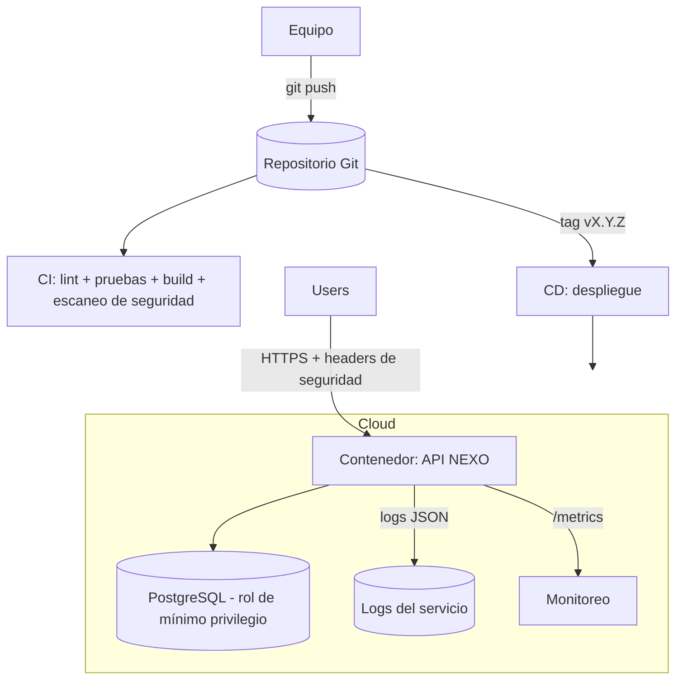

# Informe — Unidad 3: Monitoreo, pruebas y seguridad DevSecOps

> Sistema de gestión de la configuración en un ambiente Cloud, con infraestructura
> como código, monitoreo/logging, pruebas automatizadas y seguridad DevOps.
> **Integrantes:** Benjamín Nabarro — Sebastián Morales · **Asignatura:** DevOps (TILE23).

## 1. Selección y descripción del caso

**NEXO** es el sistema de gestión del comercio **ALMACÉN DOÑA PATY**. Para esta
evaluación se continúa con su **módulo de gestión de inventario**, ya desplegado
como una API REST contenerizada en la nube (Unidad 2). La necesidad detectada es
que un servicio en producción no basta con que "funcione": debe poder
**observarse, probarse y protegerse**. La Unidad 3 agrega, sobre esa base, un
sistema de gestión de la configuración que fortalece la operación, la
trazabilidad y la seguridad del entorno desplegado.

## 2. Requerimientos del proyecto

**Funcionales/técnicos:** API REST de inventario (Node.js + Express + PostgreSQL),
desplegada con IaC en un ambiente Cloud (Terraform/`render.yaml` → Render),
contenerizada con Docker.

**Nuevos requerimientos de la Unidad 3:**
- Monitoreo y logging del entorno (métricas, logs, detección de incidentes).
- Pruebas automatizadas integradas al flujo DevOps.
- Prácticas de seguridad: mínimo privilegio, gestión de accesos, protección de
  credenciales y controles en el pipeline.

**Estándares de seguridad adoptados:** mínimo privilegio en la base de datos,
secretos fuera del repositorio, escaneo de dependencias de producción sin
vulnerabilidades *high/critical*, y encabezados de seguridad en la aplicación.

## 3. Diseño general de la solución

Flujo DevOps de extremo a extremo: el código vive en Git; cada cambio dispara el
pipeline (lint + pruebas + build + **escaneo de seguridad**); la Entrega Continua
despliega en el ambiente Cloud definido como código. En operación, la aplicación
emite **logs estructurados** y expone **métricas** en `/metrics`, y aplica
**controles de seguridad** (encabezados, mínimo privilegio, secretos).

## 4. Decisiones técnicas

- **Logging estructurado JSON** (sin dependencias) para que los registros sean
  filtrables y exportables (equivalente a CloudWatch Logs).
- **Métricas en `/metrics`** en formato Prometheus, consumibles por un monitor
  externo (equivalente a CloudWatch Metrics).
- **Escaneo de seguridad en CI** con `npm audit` sobre dependencias de
  producción, como gate que bloquea vulnerabilidades altas.
- **Mínimo privilegio** en la base de datos mediante un rol acotado
  (equivalente a una política de AWS IAM), en vez de usar el usuario dueño.
- **Equivalentes a AWS**: el enunciado permite herramientas equivalentes; se
  priorizó mantener el stack ya desplegado (Render + GitHub Actions) para dar
  continuidad y reducir complejidad y costo.

## 5. Evidencias

- **Monitoreo/logging:** ver `docs/MONITOREO.md`. Evidencia: logs JSON en la
  consola de Render y salida de `GET /metrics`.
- **Pruebas automatizadas:** 15 pruebas (Jest + supertest), incluidas las de
  `/metrics` y encabezados de seguridad; se ejecutan en el pipeline.
- **Seguridad:** ver `docs/SEGURIDAD.md`. Evidencia: job `seguridad` del pipeline
  en verde, `security/roles.sql`, y encabezados de seguridad en las respuestas.

*(Las capturas se adjuntan en el informe de entrega.)*

## 6. Reflexión final del equipo

El principal aprendizaje fue que la operación de un servicio en la nube no
termina con el despliegue: **observar, probar y proteger** son parte del mismo
ciclo DevOps. La mayor dificultad fue traducir las herramientas AWS sugeridas
(CloudWatch, IAM, CloudTrail, CodeBuild) a equivalentes sobre el stack ya usado,
sin perder el sentido de cada criterio. La solución mejora la **operación**
(métricas y logs para detectar incidentes), la **seguridad** (mínimo privilegio,
secretos, escaneo que incluso detectó y permitió corregir una vulnerabilidad
real) y la **automatización** (todo validado en el pipeline), fortaleciendo la
confianza en cada cambio que llega a producción.
